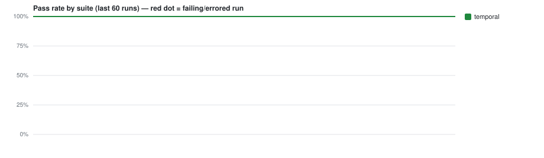

# CI test trends — `kwahalf/ai-league-predictor`

> Auto-generated by **PR Validation** (`publish-test-history`). Do not edit by hand — every
> run regenerates this branch. The machine-readable source of truth is [`runs.jsonl`](./runs.jsonl).
> Deployed-environment E2E trends live separately on the [`e2e-history`](../../tree/e2e-history) branch.

**Last updated:** 2026-11-11 15:58Z · 8 records · suites: `temporal`



## Suites

| Suite | Latest | When (UTC) | Pass 24h | Pass 7d | Green streak | Runs |
|---|---|---|--:|--:|--:|--:|
| `temporal` | ✅ `passed` [↗](https://github.com/kwahalf/ai-league-predictor/actions/runs/43053511741) | 2026-11-11 15:58Z | 100% (8) | 100% (8) | 8 | 8 |


## Recent runs

| When (UTC) | Suite | Result | Pass | Fail | Skip | Duration | Commit | Run |
|---|---|---|--:|--:|--:|--:|---|---|
| 2026-11-11 15:58Z | `temporal` | ✅ passed | 364 | 0 | 13 | 7.2s | `ca987ec` | [#37](https://github.com/kwahalf/ai-league-predictor/actions/runs/43053511741) |
| 2026-11-11 15:57Z | `temporal` | ✅ passed | 332 | 0 | 13 | 4.2s | `13e3f38` | [#36](https://github.com/kwahalf/ai-league-predictor/actions/runs/43053500151) |
| 2026-11-11 15:02Z | `temporal` | ✅ passed | 284 | 0 | 7 | 2.2s | `231f04f` | [#25](https://github.com/kwahalf/ai-league-predictor/actions/runs/43044072640) |
| 2026-11-11 14:46Z | `temporal` | ✅ passed | 265 | 0 | 7 | 2.6s | `ab9bac5` | [#22](https://github.com/kwahalf/ai-league-predictor/actions/runs/43041702117) |
| 2026-11-11 14:38Z | `temporal` | ✅ passed | 225 | 0 | 7 | 2.3s | `6b9e199` | [#20](https://github.com/kwahalf/ai-league-predictor/actions/runs/43040407722) |
| 2026-11-11 14:27Z | `temporal` | ✅ passed | 193 | 0 | 7 | 2.0s | `086d8d9` | [#16](https://github.com/kwahalf/ai-league-predictor/actions/runs/43038592517) |
| 2026-11-11 14:17Z | `temporal` | ✅ passed | 96 | 0 | 7 | 2.0s | `2ef2a4b` | [#11](https://github.com/kwahalf/ai-league-predictor/actions/runs/43036904109) |
| 2026-11-11 14:07Z | `temporal` | ✅ passed | 96 | 0 | 7 | 1.8s | `549dc9b` | [#6](https://github.com/kwahalf/ai-league-predictor/actions/runs/43035323893) |


## Unstable tests (recent window)

_No failing or flaky tests in the recent window. 🎉_


---

### Reading this data programmatically

```bash
# every line is one suite-run; newest last
git show ci-history:runs.jsonl | tail -n 20

# e.g. the unit suite's pass-rate over its last 50 runs
git show ci-history:runs.jsonl \
  | jq -rs '[.[] | select(.suite=="unit")] | .[-50:]
            | (map(select(.outcome=="passed")) | length) / length * 100'
```

Record shape: `{ ts, suite, outcome, pass_rate, stats:{expected,unexpected,flaky,skipped,total,duration_ms}, run_url, sha_short, branch, trigger, tests:[{title,file,status,duration_ms}] }`
