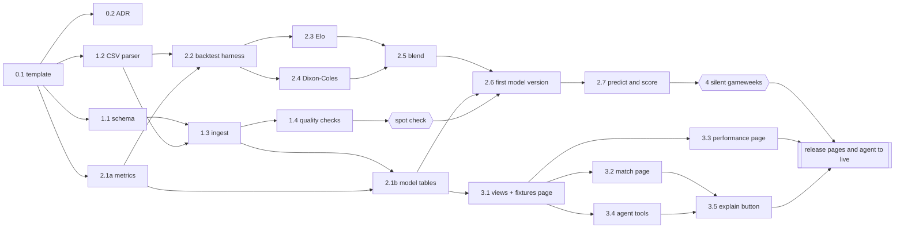

# Match Predictor Implementation Plan

**Status:** Draft
**Owner:** @kwahalf
**Spec:** [`docs/specs/2026-11-11-match-predictor.md`](../specs/2026-11-11-match-predictor.md)
**Created:** 2026-11-11

## How we'll work

- **One pull request per step** below, merged into `main` in order. Each PR is small enough to review in one sitting and leaves `main` working.
- **`main` is protected; @kwahalf gives final sign-off and merges every PR.** Nothing is pushed to `main` directly, including changes to this plan and the spec. Copilot reviews first (see "Review process"), but nothing merges automatically.
- **Every PR passes** the worker test suite (pytest in the worker image), `supabase db reset` (migrations and seed apply cleanly), and `scripts/audit/run_audits.py`. (From PR 0.1 onwards; see the bootstrap exemption under "Review process".) CI runs these on GitHub-hosted machines; local runs happen only in the **dev stack** on the runner, never the live one (see "Hosting on the runner").
- **Measure before modelling.** The scoring metrics and the backtest harness land before any model, so every model is judged the day it arrives.
- **Data first, UI last.** Nothing user-facing is built until the numbers behind it have been backtested.

Sizes are relative: **S** about a day, **M** two to three days, **L** about a week.

## Review process

Every PR goes through the same loop before @kwahalf sees it. Claude runs steps 1–5; @kwahalf does step 6.

1. **Open the PR** and wait for `pr-validation` and `architecture-audit` to pass. Fix failures before
   asking anyone to review.
2. **Request a Copilot review** on the PR.
3. **Wait for the review**, then go through every Copilot comment:
   - **Valid:** fix it, push, and reply on the thread with the commit that fixes it.
   - **Not valid, or out of scope:** reply on the thread explaining why, citing the spec, the plan or
     the code. Out-of-scope points that are still worth doing are noted in the PR summary for a later step.
4. **Request a re-review** from Copilot on the new commits, and repeat step 3.
5. **Stop the loop** when a review raises nothing new that needs a change, or after **3 rounds**,
   whichever comes first. Anything still disputed after 3 rounds is left for @kwahalf to decide, not
   argued further.
6. **Tag @kwahalf for final sign-off** in a PR comment summarising: what changed, which Copilot points
   were fixed, which were declined and why, anything left open, and CI status. @kwahalf reviews and
   merges, or comments, in which case Claude addresses the comments and tags @kwahalf again.

Notes:
- Copilot's reviews are comments only: they never approve or block a merge, so they don't conflict
  with branch protection. Final sign-off is always @kwahalf's.
- This needs Copilot code review enabled for the repository (part of a GitHub Copilot plan). PR 1,
  this plan, is the first run and confirms it works.
- **Bootstrap exemption:** the spec commit and this plan's PR come before the template, so the CI checks,
  worker tests and audit script don't exist yet for them. They skip step 1 and the "Every PR passes"
  gate, but still go through Copilot review and @kwahalf's sign-off. All gates apply from PR 0.1
  onwards; PR 0.1's own checks run because a PR runs the workflows it adds.
- This is separate from the template's `pipeline-*` workflows, which have their own automated
  review-and-merge "factory". Those stay disabled in practice (they fail without their tokens), and
  must not be given tokens while this process is in use, or PRs could be merged without @kwahalf.

## Milestone 0: Repository foundation

Goal: the template and spec on `main`, with PR validation passing and the stack running on the runner.

| # | PR | Size | Contents | Done when |
|---|---|---|---|---|
| 0.1 | Bring in the template | M | The Volaris template from branch `init/template-and-match-spec`, rebased onto `main`, with all its workflows kept (see Decisions). Make the Supabase project ID, every host port and the Docker Compose project name configurable per stack, so a **dev** and a **live** stack can run side by side on the runner without sharing containers, ports or volumes. Add a runner script that blocks outside access to the Supabase ports (the Supabase CLI can't bind them to localhost). Set the spec's owner. Rewrite `README.md` for this project. | `pr-validation` and `architecture-audit` pass on the PR; dev and live stacks run side by side, and a `supabase db reset` in dev leaves a marker row in live untouched |
| 0.2 | ADR-0001: football data gets its own tables | S | Records the decision in the spec's Data Model section, using `docs/adrs/TEMPLATE.md`. | ADR merged as Accepted |

## Milestone 1: Data foundation (spec phase 1)

Goal: 11 seasons of EPL results and odds in Postgres, refreshed daily, with checks that fail loudly.

| # | PR | Size | Contents | Done when |
|---|---|---|---|---|
| 1.1 | Football schema | M | Migration `…_football_core.sql`: `leagues`, `teams`, `matches`, `match_stats`, `bookmakers`, `odds`, plus RLS and indexes. Seed rows: EPL and the four odds sources (`B365`, `BW`, `AVG`, `PS`). | `supabase db reset` passes; audit's view checks pass. First fix the template's view audit (`scripts/audit/check_view_security_invoker.py`): it treats `WITH (security_invoker = false)`, or a comment mentioning the option, as safe. It must parse the value, with regression tests for both cases (found by Copilot in PR 0.1) |
| 1.2 | CSV parsing library | M | Pure Python, no I/O: parse a season file, map each season's odds columns (`BbAv` → `Avg`, pre-match vs closing) to the canonical shape, normalise team names through an alias table, convert kick-off times to UTC. Small fixture CSVs checked into `temporal/tests/fixtures/`, one pre-2019 and one post-2019. | Every team in all 11 real season files resolves; both fixture files parse to the expected rows |
| 1.3 | `IngestWorkflow` | M | Activities: download, parse (from 1.2), upsert idempotently. Also stores the raw CSVs in Supabase Storage. Backfill command for 2016/17–2026/27. Temporal Schedule: daily 06:00 UTC, including `fixtures.csv`. Set up the **live stack** in a long-lived checkout on the runner, with its own project ID and ports, started at boot (see "Hosting on the runner"). | Backfill loads 10 × 380 matches plus the current season; a second run changes nothing |
| 1.4 | Data-quality checks | S | A check activity run after every ingest: 380 matches per completed season, no duplicate fixtures, scores only on finished matches, odds > 1.0, margins between 0 and 15%. A failure fails the workflow visibly in the Temporal UI. | A deliberately corrupted fixture file trips each check |

**Checkpoint:** spot-check one gameweek per season against the source files by hand. Modelling can start earlier on the CSV files; the check gates step 2.6, where the first model version is recorded from the database.

## Milestone 2: Models and backtest (spec phase 2)

Goal: three model layers, honestly backtested, with live predictions being stored and scored.

| # | PR | Size | Contents | Done when |
|---|---|---|---|---|
| 2.1a | Metrics library | S | Pure Python, no database: RPS, log loss, Brier and calibration buckets, margin removal and the consensus. | Every function matches hand-computed examples |
| 2.1b | Model tables and market scores | M | Migration: `model_versions`, `team_ratings`, `predictions` (with the before-kick-off trigger), `prediction_scores`, `market_scores`. Scores the bookmakers on all history with the 2.1a library, giving the bar the models must reach. | Market RPS per season is in the database |
| 2.2 | Backtest harness and leakage tests | M | Runs from the parsed CSV files (1.2), so it doesn't need the database. Walk-forward loop: for each week, the model sees only earlier matches and only pre-match odds. The no-leakage tests from the spec go in here, before any model exists, along with a trivial "home win 45%" model to exercise the harness. | Leakage tests pass; the trivial model produces a full 9-season backtest |
| 2.3 | Elo baseline | S | Elo ratings, and an ordered-logit mapping to 1X2. | Elo backtest stored; clearly beats the trivial model |
| 2.4 | Dixon–Coles fundamentals | L | Time-weighted maximum-likelihood fit, score matrix, derived markets (1X2, xG, O/U 2.5, BTTS). Promoted-team priors. | Recovers known parameters on synthetic data; clearly beats the trivial model in the backtest (the comparison with Elo happens in 2.5, since 2.3 and 2.4 are built in parallel) |
| 2.5 | Headline blend and score solver | M | Multinomial logistic blend of fundamentals, consensus and Elo; the λ/μ solver that makes the score matrix agree with the headline 1X2; fallback to fundamentals when no odds exist. | Fundamentals RPS beats Elo; headline RPS at least matches the consensus over 2017/18–2025/26; solver within 0.5 points |
| 2.6 | Tuning and first model version | S | Tune decay half-life and blend weights via the backtest; record them as the first row in `model_versions`, with the backtest results and the promotion rule. | Spec's success-criteria table filled in with real numbers |
| 2.7 | `PredictWorkflow` and `ScoreWorkflow` | M | Daily predictions for fixtures in the next 14 days; scoring after full time; both on Temporal Schedules after ingest. Daily `pg_dump` backup of the database. | Predictions appear before kick-off and are scored after; one week runs end to end |

**Checkpoint (spec rollout plan):** run silently for at least 4 gameweeks, about a month. Compare live RPS with the backtest. Go on only if they're in line; if not, find out why first.

## Milestone 3: UI and agent (spec phase 3)

Steps 3.1–3.3 and 3.4 can be built in parallel once 3.1's views exist.

| # | PR | Size | Contents | Done when |
|---|---|---|---|---|
| 3.1 | Views and fixtures page | M | `v_upcoming_predictions`, `v_match_detail`, `v_model_performance` (with `security_invoker`); fixtures page as JSON forms under `frontend/forms/football/`. Fix the template's layout engine first: `Grid` and `Stack` build Tailwind classes at runtime (`grid-cols-${n}`, `gap-${n}`), which Tailwind never generates, so numeric columns and gaps are lost; set them as inline styles (found by Copilot in PR 0.1). | Fixtures page shows the next 14 days with edge badges |
| 3.2 | Match detail page | M | If the probability bars use the template's `Progress` component (`frontend/src/components/ui/progress.tsx`), first pass `value` through to the Radix root: it's dropped today, so screen readers announce every bar as indeterminate (found by Copilot in PR 0.1). Probability bars (headline and fundamentals), scoreline heat map, goal markets, odds table, form, strengths, head-to-head. | All match-page acceptance criteria in the spec pass |
| 3.3 | Performance page | M | RPS over time and calibration, for all layers and sources, filterable by season and model version. | Numbers match `v_model_performance` |
| 3.4 | Agent tools and `match_analyst` | M | The six read-only tools in `temporal/src/agent/tools.py`; `temporal/agents/match_analyst.yaml` on `claude-sonnet-5-5`. Also fix or retire the template's example tools (found by Copilot in PR 0.1): `list_entity_types` reads one capped page (1,000 rows) and miscounts beyond it; `record_note` creates a duplicate note if its activity is retried, because it doesn't pass a stable `p_entity_id`. The new tools must not repeat either mistake. | Config loads under `AGENT_PROVIDER=fake`; a real run explains a fixture citing only tool figures |
| 3.5 | "Explain this prediction" | S | Button on the match page that starts a `match_analyst` run for that match. Fix the template agent page's recent-runs list, which goes stale after starting a run (`frontend/src/pages/agent.json`; found by Copilot in PR 0.1). | 20-explanation faithfulness spot check passes |

## Milestone 4: Extensions (spec phase 4)

Goal: make the predictor broader and sharper, but only where the live track record says it's worth it.
Milestone 4 is three independent tracks. Each starts with its own go/no-go decision and can be
dropped without affecting the others.

**Entry gate:** milestone 3 shipped, and at least 10 live gameweeks scored, so that changes are judged
against a real track record, not just the backtest. Every model change in this milestone goes through
the promotion rule from step 2.6: it replaces the current version only if it beats it.

### Track A: Second league

The free data already covers it. Checked on 2026-11-11: the Championship (`E1`) and La Liga (`SP1`),
among others, have Bet365, Bwin and market-average odds in all 11 seasons and in `fixtures.csv`, in the
same format as the EPL.

| # | PR | Size | Contents | Done when |
|---|---|---|---|---|
| 4.A1 | Second league data | M | League row and team aliases; ingest and quality checks parameterised by league; backfill 2016/17–2026/27. | All 11 seasons load and pass the quality checks |
| 4.A2 | Per-league models and backtest | M | Fit Elo, Dixon–Coles and the blend per league; backtest the new league with the same harness and leakage tests. | Backtest meets the same success criteria as the EPL, or the gap is understood and recorded |
| 4.A3 | League in the pages and agent | S | League switch on the fixtures and performance pages; agent tools take a league. | Both leagues browsable; the agent answers for either |

**Go/no-go:** which league, and whether its backtest is good enough to show. The Championship is the
natural next step (promoted teams in the EPL arrive with Championship history, which also helps
the EPL model's ratings for promoted teams).

### Track B: Team news (paid feed)

The only part of phase 4 that needs paid data. Lineups and injuries aren't in the free CSVs.

| # | PR | Size | Contents | Done when |
|---|---|---|---|---|
| 4.B1 | Provider evaluation and ADR | S | Compare 2–3 providers (for example API-Football, Sportmonks) on EPL coverage, how far back lineups and injuries go, update timing before kick-off, cost, and licence terms. Note whether the feed also carries live Pinnacle odds, which would restore a live sharp benchmark (spec open question). | ADR accepted naming a provider and a monthly budget, or rejecting all of them |
| 4.B2 | Team-news ingest | M | New tables for lineups, injuries and suspensions, matched to `matches` and `teams`; scheduled pulls on match days. API key in `.env`, never committed. | A full gameweek's team news is stored and matched to fixtures |
| 4.B3 | `get_team_news` agent tool | S | Read-only tool, so the agent can talk about absences, citing the feed. The "doesn't know" rule stays for anything the feed doesn't cover. | The agent mentions a confirmed absence only when the tool returned it |
| 4.B4 | Team news as a model input | M | Add availability features (for example share of usual starters missing) to the fundamentals model. | Beats the current version under the promotion rule |

**Go/no-go:** 4.B1 decides whether this track happens at all. 4.B4 also needs enough **history** of team
news to backtest. If the provider's history is thin, collect it live for a season first and run 4.B4
afterwards. Expect a small gain: the odds already price most team news in.

### Track C: Richer fundamentals

Uses data we already ingest. Shots (`HS`, `AS`) and shots on target (`HST`, `AST`) are in every
season file.

| # | PR | Size | Contents | Done when |
|---|---|---|---|---|
| 4.C1 | Shots-informed ratings | M | Add shots on target as a second signal in the fundamentals model: it's less noisy than goals, so ratings settle faster early in a season. | Fundamentals RPS improves in the backtest, especially in the first 10 gameweeks |
| 4.C2 | Gradient-boosting challenger | L | A boosted model over rating differences, form, rest days and market odds, trained walk-forward with the same leakage tests. | Beats the current headline model under the promotion rule, or is recorded as a negative result |

**Go/no-go:** each is promoted only if it wins. A losing challenger is still worth recording in
`model_versions`, so nobody repeats the experiment blind. True expected-goals models need shot
locations, which aren't in the free data. They'd come from the Track B provider, if it offers them.

### Decisions needed for milestone 3

- [ ] **Model route for `match_analyst` (by step 3.4).** The template recommends calling Claude
      directly (`provider: claude`, needs `ANTHROPIC_API_KEY`), because routing Claude through
      LiteLLM loses thinking blocks. The current key is for the hosted LiteLLM proxy, which serves
      Claude models and `gpt-6-sol`. Options: an Anthropic key for `provider: claude`; Claude through
      the hosted proxy (works today, accepting the loss); or `gpt-6-sol` through the proxy.

### Decisions needed for milestone 4

- [ ] Which second league (Track A).
- [ ] Monthly budget for a team-news feed, if any (Track B).

## Parallel delivery with multiple agents

Steps that don't depend on each other are built at the same time by separate Claude agents. The order
of work is set by real dependencies below, not by step numbers.

### Who does what

- **Coordinator** (the main Claude session): picks the next steps, starts an agent for each, watches
  their PRs, and posts the final summary that tags @kwahalf. One coordinator, so there's one place to
  ask "what's in flight?".
- **Worker agents:** one agent per step, so **one agent = one branch = one PR**. Each works in its own
  git worktree (a separate working folder on its own branch), runs the review process steps 1–5
  (CI, Copilot review, fixes, re-review), and hands back to the coordinator.
- **@kwahalf:** final sign-off and merge, unchanged.

### Real dependencies

| Step | Can start when these have merged |
|---|---|
| 0.2, 1.1, 1.2, 2.1a | 0.1 |
| 1.3 | 1.1, 1.2 |
| 1.4 | 1.3 |
| 2.1b | 1.3, 2.1a |
| 2.2 | 1.2, 2.1a |
| 2.3, 2.4 | 2.2 |
| 2.5 | 2.3, 2.4 |
| 2.6 | 2.5, 2.1b, 1.4 and the spot check |
| 2.7 | 2.6 |
| 3.1 | 2.1b |
| 3.2, 3.3, 3.4 | 3.1 |
| 3.5 | 3.2, 3.4 |
| **Release of milestone 3 to live** | 2.7, 3.3, 3.5, and the 4-gameweek comparison passed |
| Milestone 4 tracks | milestone 3 shipped and 10 live gameweeks scored |

What this unlocks:
- **Pure-code steps run beside the data work.** The CSV parser (1.2), metrics (2.1a), backtest harness
  (2.2) and the models (2.3, 2.4, 2.5) don't touch the database: the backtest reads the parsed CSV
  files directly. Models are developed while ingestion is still being built.
- **Elo (2.3) and Dixon–Coles (2.4) are built at the same time** on top of the harness.
- **The UI starts early, in dev only.** Pages (3.1–3.4) are built against the views with sample rows as
  soon as the model tables exist (2.1b), instead of waiting for real predictions. The sample rows live
  in a dev-only seed, never in a migration, so they can't reach the live database. Merging a page to
  `main` doesn't put it in front of anyone: live only gets milestone 3 at the release gate below.
- **Milestone 4's three tracks run in parallel.**
- **The spot check moves:** it gates step 2.6 (when a real model version is recorded from the
  database), not the start of modelling.

**Critical path** (the chain that sets the finish date): 0.1 → 1.2 → 2.2 → 2.4 → 2.5 → 2.6 → 2.7.
Dixon–Coles (L) is the longest step on it, so it gets an agent as soon as 2.2 merges. As a rough
guide, sizes along the critical path add up to about 18 working days to the start of the silent month,
against about 31 if every step ran one after another, before review waiting time.

### Rules for running agents in parallel

- **At most 3 agents at once**, for two reasons: @kwahalf's review time (no more than 3 PRs waiting
  for sign-off at a time), and the runner (2 CPUs, about 7.6 GB RAM, about 9 GB free disk).
- **Only one agent uses a database at a time.** The runner fits the live stack plus **one** dev stack
  (a full stack uses about 2.3 GB of RAM). Steps that need Supabase (1.1, 1.3, 1.4, 2.1b, 2.7, 3.1–3.5)
  queue for the dev stack. Pure-code steps run their tests in the worker image alone, which is cheap.
- **One migration at a time.** Only the agent holding the dev stack may add a migration, so migration
  timestamps and order never conflict.
- **Agents start from `main`, never from another agent's unmerged branch.** A step starts only when
  every step it depends on has merged. No stacked PRs.
- **Stay in your lane.** Each step lists the files and folders it owns in its PR description. If an
  agent needs to change something another open PR owns, it stops and tells the coordinator instead.
- **Heavy backtests run in CI, not on the runner.** Full 9-season walk-forward runs for 2.4–2.6 are
  CPU-heavy. They run as a GitHub Actions job on GitHub's machines, with only small backtests locally.
- **Copilot reviews each PR independently,** and the 3-round cap applies per PR.

If more parallelism is wanted later, agents can run as separate cloud Claude sessions instead of on
this runner, testing through CI. Then the limits are review time and the one-migration rule, not the
runner.

## Known template issues

Found in review and not tied to a step, because this project doesn't use the code yet:

- **The bundled local LiteLLM proxy doesn't serve the example agent's model.** `litellm/config.yaml`
  serves `gpt-5.5` and `workshop-default` only, and deliberately not Claude ("DO NOT ROUTE CLAUDE
  THROUGH HERE": the round trip loses thinking blocks; use `provider: claude`). The example agent
  uses `claude-sonnet-5-5` through the hosted proxy instead, which works. See the provider decision
  for 3.4 below.

- **Azure GPT `v1` style:** `temporal/src/agent/llm/azure_gpt.py` sends the dated default
  `api-version` to the `/openai/v1` endpoint, which rejects dated versions. Fix before anyone sets
  `AGENT_PROVIDER=azure_gpt` with `AZURE_OPENAI_API_STYLE=v1`. This project uses LiteLLM.

## Decisions

- [x] **Owner:** @kwahalf (the spec's `Owner` field is updated in PR 0.1).
- [x] **Reviews:** Copilot reviews every PR first and Claude addresses its feedback (see "Review
      process"); @kwahalf gives final sign-off and merges; `main` is protected. Protection requires a
      pull request with 0 required approvals, because GitHub doesn't let an author approve their own
      PR and these PRs are opened from the `kwahalf` account.
- [x] **Hosting:** the stack runs on the current self-hosted runner. See "Hosting on the runner" below.
- [x] **Workflows:** all 14 template workflows are kept for now; pruning is deferred. Until their
      secrets exist (Azure registry, Kubernetes, Copilot and Azure OpenAI tokens), the deploy,
      monitor, e2e, enrichment and `pipeline-*` workflows are expected to fail, and only
      `pr-validation` and `architecture-audit` are meaningful. A red run from one of the others is
      not a blocker for merging. Revisit if the failure noise or Actions minutes become a problem.

## Hosting on the runner

The runner is a shared organization machine, so a few things need care. They're folded into the
steps where they first matter:

- **Two stacks that share nothing.** The **dev stack** is where PRs are built and tested, and the
  only place `supabase db reset` may ever run. The **live stack** runs the schedules and holds the
  real data. They use different Supabase project IDs, host ports and Compose project names, so
  their containers and volumes are separate (the Supabase CLI names both after the project ID, so a
  separate folder alone is not enough). Made possible in PR 0.1.
- **Live is never reset.** New migrations reach live with `supabase migration up`, which only applies
  what's new, and only after a fresh backup. A migration that would drop or rewrite stored predictions
  needs @kwahalf's explicit sign-off in its PR.
- **Live runs tagged releases, not the latest `main`.** The live checkout is pinned to a release tag
  (for example `v0.1`), and moving it to a newer tag is a deliberate step after @kwahalf's sign-off.
  Merged work, including early UI, reaches live only through a release. Milestone 3 (pages and agent)
  is released to live only after step 2.7 and a successful 4-gameweek comparison of live RPS against
  the backtest.
- **Run live from a stable checkout, not a session folder.** Session workspaces aren't guaranteed to
  last. Before the first schedule goes live (step 1.3), the live stack moves to a long-lived clone of
  the repo outside the session directories.
- **Start on reboot.** Add a systemd unit (or similar) that runs the stack at boot, in step 1.3, so
  the daily schedules survive a restart.
- **Keep ports private.** The Supabase CLI listens on all network interfaces (API, Postgres, Studio
  and others) and has no setting to bind them to localhost. PR 0.1 adds
  `scripts/runner/restrict-supabase-ports.sh`, which blocks outside access in Docker's firewall chain;
  it's run at boot from step 1.3. Reach the app through an SSH tunnel.
- **Back up the live database.** Daily `pg_dump` from step 2.7 on, plus one before every migration. From then on the stored predictions are
  the model's live track record and can't be recreated after the fact.
- **The Temporal UI is on port 8081, not 8080,** because the runner's own process uses 8080
  (`TEMPORAL_UI_PORT=8081 make up`).

